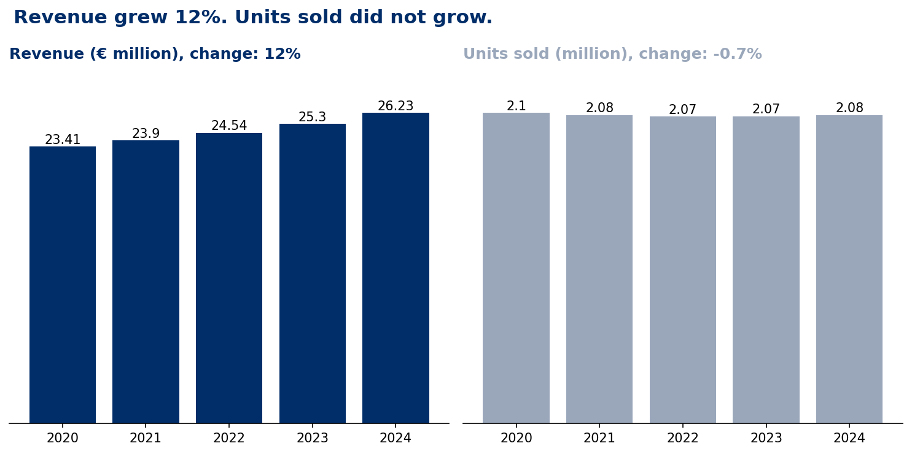
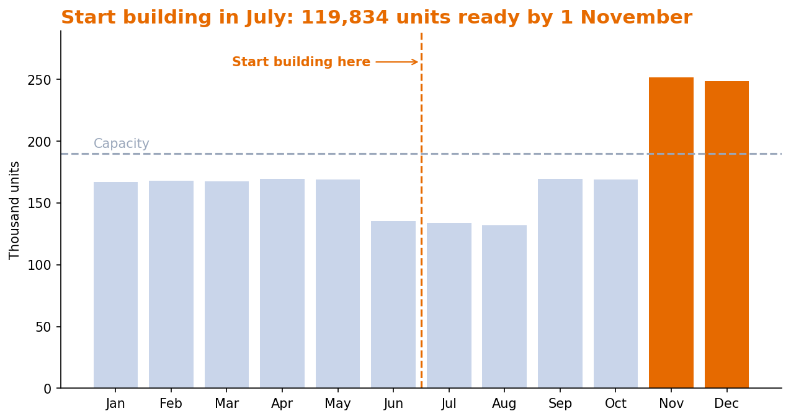

# Preventing a potential €127K loss by analysing SKU margin. Four decisions from 60 messy Excel Tabs.
Python (pandas, matplotlib) · 396,978 order lines from 60 Excel tabs, 2020 to 2024 · Fictional company, simulated data · Technical documentation
## Executive Summary

La Widgeterie manufactures 20 industrial parts and sells them to 275 wholesalers across France. The company faced four decisions: whether to renew a sales bonus plan, when to build inventory for peak demand, whether to discontinue an underperforming SKU, and how to manage the risk of a wholesaler failing. These decisions required analysing five years of sales data spread across 60 Excel tabs. Taking the role of a Supply Chain Analyst, I cleaned and combined the data using Python to evaluate each decision and provide recommendations to management.

**My recommendation to the COO: Do not renew the annual sales bonus plan.** Revenue increased by 12% between 2020 and 2024, but average annual units sold declined from 2.09 million before the plan to 2.07 million after its introduction in 2022. The increase in revenue reflected higher average selling prices rather than growth in units sold.

For the remaining decisions, **retain SKU-9325**, as discontinuing it would save €150,000 annually but put €262,039 in contribution margin at risk. **Begin building inventory in July** to ensure 119,834 units are available by 1 November. **Sign the backup agreement with Payet** to manage Carpentier's financial risk, as the wholesaler accounts for 37.6% of sales in its region.

## Findings:
### 1. Do Not Renew the Sales Bonus Plan: Revenue Grew, but Units Sold Declined

 La Widgeterie should not renew the sales bonus plan or increase its annual budget. The plan did not meet the company's requirement of increasing average annual units sold.

Revenue increased by 12% between 2020 and 2024, but average annual units sold declined from 2.09 million before the plan to 2.07 million after its introduction in 2022.

 The revenue increase reflected a higher average selling price per unit rather than an increase in units sold. Despite higher revenue, the company sold fewer units per year after the plan was introduced.

 
 

### 2. Start Building Inventory in July to Prepare for November's Peak Demand

 La Widgeterie should begin building inventory in July to meet November's peak demand while avoiding unnecessary early stock accumulation.

The plant can produce a maximum of 190,000 units per month. Starting production at maximum capacity in July would leave 119,834 units in the warehouse by 1 November.

  July has enough spare production capacity to meet its own demand while producing additional units for August. Building inventory from July allows the plant to prepare for November's peak without starting production earlier than necessary.

### 3. Keep SKU-9325: dropping it saves €150K a year but loses €262K of margin

Keep SKU-9325. Dropping it would cost €112,039 more in margin each year than it saves.

 Dropping it would save €150,000 a year, but the company would lose €262,039 of margin: €112,314 on SKU-9325 itself and €149,725 on other parts that four wholesalers would move to a competitor.

 SKU-9325 alone represents only 1.4% of revenue, so dropping it looks like a cheap cut. But four wholesalers buy it in the same orders as other parts, and they said they would move every order that includes it, with €499,084 of sales of other parts.

 

### 4. Sign the Payet Agreement to Reduce Wholesaler Financial Risk

La Widgeterie should sign the backup agreement with Payet to reduce potential losses if Carpentier fails.

 Carpentier accounts for 2.4% of company revenue but 37.6% of sales in Bourgogne-Franche-Comté. Its estimated failure probability is 25%, above the 15.8% break-even threshold for the agreement.

  Although Carpentier represents a small share of total company revenue, its regional sales concentration creates greater exposure. The estimated failure probability exceeds the threshold at which the expected margin protected by the agreement outweighs its cost.

  ## Recommendations:

| Priority | Action | Expected impact | Metric to track | Owner |
|---|---|---|---|---|
| 1 | Do not renew the sales bonus plan this year or increase its budget to €400,000. | Save €250,000 annually on a plan that did not increase average annual units sold. | Annual units sold compared with the pre-plan average of 2,088,694 units. | COO and Head of Sales |
| 2 | Sign the €15,000 annual backup agreement with Payet now. | Reduce expected annual loss by €8,733, from €33,227 to €24,494, and retain 80% of Carpentier's business if it fails. | Carpentier's payment delays and insurer's failure probability against the 15.8% break-even threshold. | CFO and Head of Sales |
| 3 | Build 19,897 units in July, then operate at full capacity from August to October. | Have 119,834 units in stock by 1 November to meet peak demand without overtime. | Monthly inventory against plan, late deliveries and overtime hours during November and December. | Plant Manager |
| 4 | Retain SKU-9325 and reject the proposed discontinuation. | Preserve €262,039 in annual contribution margin, €112,039 more than the €150,000 in potential savings. | Orders and contribution margin from the four affected wholesalers. | CFO and Head of Sales |

  

